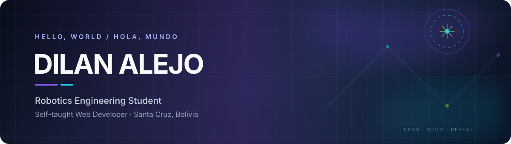

  

  
  
  

<i>Aprendo construyendo. Cada proyecto es una excusa para entender algo nuevo.</i>

---

No empecé en la programación. Empecé en una estación de servicio, en una pastelería y en obras de construcción. Después llegué a la universidad, a Ingeniería en Robótica, y encontré en el desarrollo web la forma de construir cosas sin depender de materiales.

Hoy curso el segundo semestre en la **Universidad Gabriel René Moreno** (Santa Cruz, Bolivia) y aprendo desarrollo web por mi cuenta: HTML, CSS, JavaScript, TypeScript y todo lo que aparezca en el camino. Me interesa el punto exacto donde el software y el hardware se tocan — automatización, electrónica y la web como interfaz de todo eso.

Trabajo tranquilo, pregunto cuando no sé y termino lo que empiezo. La mayor parte de lo que sé la aprendí haciendo.

**Ahora mismo** · Segundo semestre de Ingeniería en Robótica · construyendo `nexus-gate` y `promptforge` · aprendiendo TypeScript, Next.js y Supabase.

  

- **Web** — HTML, CSS, JavaScript, TypeScript, React, Next.js, Tailwind CSS
- **Backend y datos** — Node.js, Prisma, Supabase
- **Herramientas** — Git, GitHub, VS Code y flujos de desarrollo asistido por IA
- **Hardware** — Arduino y electrónica básica
- **Idiomas** — Español (nativo) · Inglés (básico) · Quechua (básico)

<i>Lo que aparece aquí forma parte de mi proceso de aprendizaje, no es una declaración de experiencia profesional.</i>

<table cellspacing="0" cellpadding="4">
  <tr>
    <td width="50%" align="center" valign="top">
      
      <a href="https://promptforge-one-cyan.vercel.app">Demo en vivo</a> · <a href="https://github.com/DIlan-Alejo/promptforge">Código</a>
    </td>
    <td width="50%" align="center" valign="top">
      
      <a href="https://github.com/DIlan-Alejo/nexus-gate">Código</a>
    </td>
  </tr>
  <tr>
    <td width="50%" align="center" valign="top">
      
      <a href="https://github.com/DIlan-Alejo/cv-vitale">Código</a>
    </td>
    <td width="50%" align="center" valign="top">
      
      <a href="https://github.com/DIlan-Alejo/Dilan-Alejo">Código</a>
    </td>
  </tr>
</table>

También estoy construyendo <b>Lumicodo</b>, una página para aprender a programar desde cero con HTML, CSS y JavaScript. Muy pronto habrá más proyectos por aquí.

**Formación**

- **Ingeniería en Robótica** — Universidad Gabriel René Moreno · Santa Cruz, Bolivia · *2.º semestre, 2026*
- **Técnico Operador en Computador** — CEPRO · Cochabamba, Bolivia · *titulado, 2025*
- **Química Industrial** — Tecnológico Industrial Boliviano Canadiense · Cochabamba, Bolivia · *2 años cursados, 2024*
- **Bachiller en Humanidades** — Colegio María Auxiliadora de Apote, El Paso · *2023*

**Experiencia**

- **Atención al cliente** — Surtidor Fortaleza E.S.A. · Cochabamba · *2024* — atención directa al público y apoyo en las operaciones diarias.
- **Ayudante de pastelería** — Cochabamba · *2024* — preparación de masas, orden y limpieza del área de trabajo.
- **Oficios y trabajo práctico** — construcción, plomería, pintura, jardinería, limpieza y electricidad · aprendizaje directo en distintos proyectos.

**Logros**

- Abanderado y diplomado de kínder a 6.º de primaria.
- Campeón y subcampeón en torneos de fútbol.
- Rendimiento académico constante durante toda la etapa escolar.

**Formación complementaria**

- Taller de robótica básica · cursos vocacionales · cursos de emprendimiento · cursos de liderazgo · taller de peluquería básica.

  

  
  

  
  

<!--
  ✏️ QUÉ EDITAR ANTES DE PUBLICAR
  1. Correo: reemplaza "tu-correo@ejemplo.com" (aparece 2 veces: en el href mailto y en el badge).
     Para el badge, escribe tu correo en formato URL, por ejemplo: dilan%40gmail.com
  2. Teléfono: no lo incluí por privacidad. Si quieres mostrarlo, agrega aquí debajo:
     - 📞 +591 XXXXXXXX
  3. Si Lumicodo ya tiene dominio, cámbialo por un enlace real.
-->

<b>Valores</b> · honestidad · responsabilidad · respeto · solidaridad — <b>Fuera del código</b> · caminar, entrenar, videojuegos y estudiar

  

